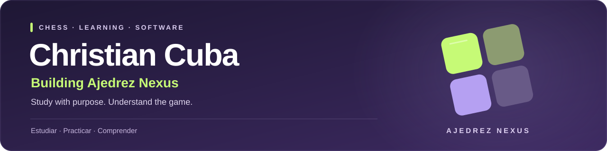

## About me · Sobre mí

I'm **Christian Cuba**, creator of **Ajedrez Nexus**. I'm building a connected workspace for chess players and coaches: a place to prepare openings, practice with guidance and understand games through analysis.

Soy **Christian Cuba**, creador de **Ajedrez Nexus**. Estoy construyendo un espacio conectado para jugadores y entrenadores: preparar aperturas, practicar con orientación y comprender las partidas a través del análisis.

> **Current focus · Ahora** 
> Refining Nexus and improving its learning experience. 
> Mejorar Nexus y su experiencia de aprendizaje.

If you play chess, coach or want to collaborate, **[let's talk](mailto:xtiancuba90@gmail.com?subject=Ajedrez%20Nexus)**. 
Si juegas ajedrez, das clases o te interesa colaborar, **[conversemos](mailto:xtiancuba90@gmail.com?subject=Ajedrez%20Nexus)**.

## Ajedrez Nexus

**Opening preparation, guided practice and analysis — together.**

Local Windows build · Captured November 18, 2026 · Click the image to enlarge.

- **Prepare:** explore openings, build your repertoire and review lines.
- **Practice:** guided lessons, tactics and endgames with saved progress.
- **Understand:** Stockfish analysis and annotated PGN, PDF and HTML studies.

[Explore the complete visual tour](https://github.com/KamuiSenpai/ajedrez-nexus/blob/main/docs/GALLERY.md) · [Product status](https://github.com/KamuiSenpai/ajedrez-nexus/blob/main/docs/PRODUCT_STATUS.md)

<strong>Español · Conoce Nexus</strong>

- **Preparar:** explorar aperturas, construir tu repertorio y repasar líneas.
- **Practicar:** lecciones, táctica y finales con progreso guardado.
- **Comprender:** análisis Stockfish y estudios comentados en PGN, PDF y HTML.

La captura corresponde a la versión local Windows del **18 de noviembre de 2026** y puede ampliarse. La interfaz actual está en español; Mac e inglés completo están previstos. El código permanece privado y no se anuncia una descarga pública.

Para clases, comentarios o colaboración, **[escríbeme](mailto:xtiancuba90@gmail.com?subject=Ajedrez%20Nexus)**.

**Availability:** Windows, Spanish UI. Mac and full English interface are planned. Application source remains private; no public download is announced.

---

**Christian Cuba** · [xtiancuba90@gmail.com](mailto:xtiancuba90@gmail.com)
